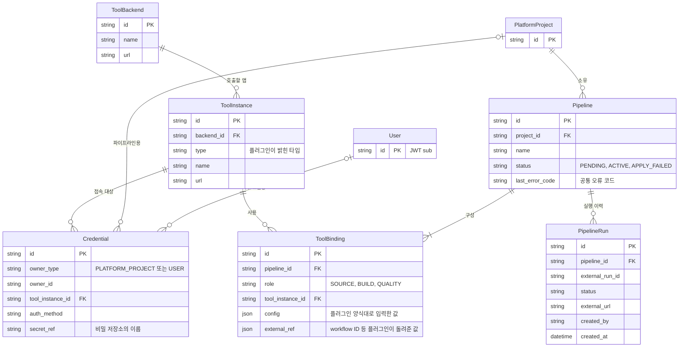

# 도구 연동은 Platform이 지휘하는 동기 호출과 분류별 Tool Backend 플러그인으로 만든다

GitHub, Gerrit 같은 저장소와 Jenkins, GitHub Actions 같은 빌드 도구를 여러 인스턴스로 연결하고, 화면에서 파이프라인을 구성하고 실행한다.
GitLab 같은 같은 종류의 도구, SVN 같은 전혀 다른 저장소, SonarQube나 CNPG 같은 새 분류의 도구가 들어와도 변경을 최소로 해야 한다.
그래서 Platform Backend가 호출 순서를 지휘하고, 도구별 차이는 분류별 Tool Backend 안의 플러그인에 가둔다. 컴포넌트 사이는 이벤트 없이 동기 호출로 잇는다.

## Status

Accepted (설계 확정, 2026-11-09). 구현 전이다.

## 구성

```
Web        → Platform ─────┐
                           ├→ Tool Backend(플러그인) → 도구
외부 호출자 → Tool Gateway ┘
```

| 구성 | 역할 | 하지 않는 일 |
|---|---|---|
| Web | 플러그인이 준 양식대로 입력 화면을 그린다 | Tool Backend 직접 호출 |
| Platform Backend | Web의 유일한 입구. 권한, 업무 규칙, 저장, 호출 순서 | 도구 이름에 따른 분기 |
| Tool Backend | 분류별 앱. 플러그인을 골라 도구를 호출하고 결과를 공통 형식으로 돌려준다 | 사용자 권한 판단, 데이터 저장 |
| 플러그인 | 도구 종류 하나를 구현. 특성, 입력 양식, 인증 방식을 밝히고 검증과 호출을 한다 | 다른 플러그인 호출 |
| Tool Gateway | 외부 호출의 유일한 입구. 개인 JWT 확인, 감사 로그 | 토큰 읽기, 업무 규칙 |

### Platform 내부 계층

| 계층 | 맡는 일 | 예 |
|---|---|---|
| 앱 서비스 | 호출 순서만 정의한다 | `PipelineService`: 검사 → 검증 → 저장 → 적용 |
| 엔티티 | 자기 상태 규칙 | `Pipeline`: 필수 역할(SOURCE, BUILD) 확인 |
| 도메인 서비스 | 여러 대상에 걸친 규칙 | `ToolCompatibility`: 도구 조합 검사 |
| 포트 | 도메인이 바깥을 부르는 인터페이스 | `ToolGateway`(Tool Backend 호출), `SecretStore`(쓰기만) |

`ToolGateway` 포트는 Platform 내부 인터페이스이고, 외부 입구인 Tool Gateway 앱과 다르다.

### 분류와 앱

분류마다 플러그인 계약이 따로 있다(`SourcePlugin`, `PipelinePlugin`, `QualityPlugin`, `DatabasePlugin` 등). 모두 공통 `ToolPlugin`(`spec`, `verify`, `proxy`)을 잇는다.
앱은 권한 범위, 실행 시간, 담당 팀이 다를 때 나눈다.

| 앱 | 플러그인 |
|---|---|
| Dev Tool Backend | GitHub, Gerrit, GitLab, SVN, Jenkins, Actions |
| Quality Tool Backend | SonarQube |
| Database Backend | CNPG |
| Provisioning Backend | Helm, Ansible |

`ToolController`와 `PluginRegistry`는 공통 라이브러리로 묶어 새 앱은 플러그인만 작성한다.

## 결정

1. **플러그인 등록**: 타입은 플러그인을 코드로 배포해야 생긴다. 앱 주소(`ToolBackend`)와 인스턴스는 설정 파일 없이 화면에서 DB에 등록한다. 타입 목록은 등록된 모든 앱의 `GET /v1/tool-types`를 병렬로 실시간 호출해 합치고, 응답 없는 앱은 "응답 없음"으로 표시한다.
2. **도구 조합**: 저장소 플러그인은 제공 특성을(GitHub: `git`, `actions`), 빌드 플러그인은 필요 특성을 "이 중 하나"(`requiresAnyOf`)로 밝힌다(Jenkins: `git`, `svn` / Actions: `actions`). 겹치는 값이 없으면 업무 오류다. Platform은 도구 이름을 모른 채 값만 비교한다.
3. **파이프라인 구조**: `Pipeline`은 고정된 칸 대신 `bindings`(역할 + 도구 인스턴스 + 도구별 `config`) 목록을 갖는다.
4. **도구별 데이터**: 양식과 검증은 플러그인이 맡고, 값은 Platform DB에 JSON으로 저장한다. Platform은 내용을 해석하지 않는다. Tool Backend에는 저장소가 없다.
5. **플러그인 사이의 값 전달**: 플러그인끼리 호출하지 않는다. clone 주소나 스캔 정보는 Platform이 받아서 다음 호출에 넘긴다.
6. **오래 걸리는 작업**: 동기 호출로 접수하고 실행 ID를 돌려받은 뒤, `status`를 동기로 조회한다.
7. **적용 실패**: `PENDING` 저장 → `apply` → 성공 시 `ACTIVE`, 실패 시 `APPLY_FAILED`. `apply`는 같은 Pipeline ID로 다시 불러도 덮어쓴다.
8. **도구에서 직접 고친 경우**: 감지하거나 자동으로 되돌리지 않는다. `apply`는 Web에서 저장할 때만 돈다. 실패하면 `status`의 이유와 `externalUrl`을 보고 사용자가 고친다.
9. **비밀값**: Platform은 비밀 저장소에 쓰기만, Tool Backend는 읽기만 한다. Platform DB에는 `secretRef`만 둔다.
10. **인증 정보 두 종류**: 파이프라인 작업은 Platform Project + 인스턴스 Credential(Project Owner가 등록), 외부 호출은 사용자 + 인스턴스 Credential(프로파일 화면에서 본인이 등록)만 쓴다. 서로 대체하지 않으며, 없으면 `CredentialNotConfigured` 오류다.
11. **앱 간 인증**: Platform과 Tool Gateway는 사내 IdP의 서비스 계정 JWT로 Tool Backend를 호출하고, Tool Backend는 발급자와 `aud`를 검사한다. 네트워크도 두 앱에서 오는 호출만 연다. Platform JWT로는 Project 토큰만, Gateway JWT로는 개인 토큰만 쓸 수 있다.
12. **외부 호출**: Platform과 Tool Backend를 외부에 열지 않고 Tool Gateway → Tool Backend `/proxy`로만 받는다. Gateway는 Platform이 비밀 저장소에 써 둔 인스턴스 정보(주소, 타입, 호출할 앱)를 읽으므로 Platform을 호출하지 않는다.
13. **공통 오류 코드**: Tool Backend는 아래 코드 중 하나로 오류를 돌려준다.

| 코드 | 뜻 | Platform 처리 |
|---|---|---|
| `UNSUPPORTED` | 지원 안 하는 기능 | 업무 오류 |
| `INVALID_CONFIG` | 입력 오류(필드별 메시지 포함) | 입력 양식에 표시 |
| `AUTH_FAILED` | 토큰 오류 | Credential 수정 안내 |
| `NOT_FOUND` | 도구에 대상 없음 | "다시 적용" 안내 |
| `TOOL_UNAVAILABLE` | 도구 장애 | 재시도 안내 |

14. **계약 버전**: URL에 `/v1`을 둔다. 호환되는 변경은 `/v1` 안에서 하고, 받는 쪽은 모르는 필드를 무시한다. 호환이 깨질 때만 `/v2`를 만들어 일정 기간 함께 제공한다. 플러그인 계약은 공통 라이브러리 버전으로 맞춘다.

## 엔티티

모두 Platform DB에 저장한다. Tool Backend와 Tool Gateway에는 엔티티가 없다.



- `Credential`은 `owner_type`, `owner_id`, `tool_instance_id` 조합이 유일하다.
- `ToolBinding`은 `Pipeline` 없이 존재하지 않으며, `Pipeline`을 통해서만 바꾼다.
- `PlatformProject`와 `User`는 다른 컨텍스트가 소유하고 여기서는 ID로만 참조한다.
- 타입과 `ToolSpec`은 플러그인이 알려 주는 값이라 저장하지 않는다. 품질 결과도 도구에서 실시간으로 읽는다.

## 코드 구조

파이프라인 생성 흐름이다. 실선은 호출, 점선은 인터페이스에서 구현체로의 연결이다.

```mermaid
%%{init: {"flowchart": {"nodeSpacing": 16, "rankSpacing": 28, "padding": 6}}}%%
flowchart LR
    Web["Web"]

    subgraph PLATFORM["Platform Backend"]
        PC["PipelineController"]
        PS["PipelineService"]
        TC["ToolCompatibility"]
        P["Pipeline"]
        PR["«interface»<br/>PipelineRepository"]
        TG["«interface»<br/>ToolGateway"]
        HTG["HttpToolGateway"]
        DB[("Platform DB")]
    end

    subgraph TOOL["Dev Tool Backend"]
        TCT["ToolController"]
        REG["PluginRegistry"]
        SP["«interface»<br/>SourcePlugin"]
        PP["«interface»<br/>PipelinePlugin"]
        GH["GitHubPlugin"]
        AC["ActionsPlugin"]
    end

    subgraph INSTANCE["Tool Instance"]
        GI["GitHub (gh-1)"]
        AI["GitHub Actions (act-1)"]
    end

    Web -->|"① bindings"| PC
    PC -->|"② projectId, bindings"| PS
    PS -->|"③ 특성"| TC
    PS -->|"④ PENDING<br/>⑦ ACTIVE"| P
    PS -->|"⑤ ⑧"| PR
    PR -->|"status, bindings"| DB
    PS -->|"⑥ pipelineId, config"| TG
    TG -.-> HTG
    HTG -->|"ToolTarget, config"| TCT
    TCT -->|"type"| REG
    REG --> SP
    REG --> PP
    SP -.-> GH
    PP -.-> AC
    GH -->|"token → cloneUrl"| GI
    AC -->|"token, config → workflowId"| AI

    classDef iface fill:#eef,stroke:#669,stroke-dasharray:4 3
    class PR,TG,SP,PP iface
```



### k8s와의 대응

| 이 설계 | k8s |
|---|---|
| Platform Backend | API Server + Controller |
| Tool Backend 플러그인 | CSI Driver |
| `ToolSpec` | CSI `GetPluginCapabilities` |
| `requiresAnyOf` | node affinity `In` |
| `apply`, `Pipeline.status` | `kubectl apply`, `status` |

다른 점은 하나다. k8s는 watch와 재조정 루프로 맞춰 가지만, 여기서는 Platform이 순서대로 동기 호출한다.

## API

모두 `/v1` 아래에 있다. Tool Backend 호출에는 `ToolTarget(type, url, secretRef)`가 함께 간다.

### Admin

| API | 권한 |
|---|---|
| `POST·GET /tool-backends` | Platform Admin |
| `GET /tool-types` | Platform Admin |
| `POST·GET /tool-instances` | Platform Admin |
| `PUT /projects/{id}/tools/{instanceId}/credential` | Project Owner |
| `PUT /me/tools/{instanceId}/credential` | 본인 |

### Repo

| Platform | Tool Backend |
|---|---|
| `GET /projects/{id}/tools/{instanceId}/repositories` | `POST /repo/search` |
| (내부 호출) | `POST /repo/checkout-info` |

### Pipeline

| Platform | Tool Backend |
|---|---|
| `GET /tool-instances/{id}/config-schema` | `GET /pipeline/config-schema` |
| `POST /projects/{id}/pipelines` | `POST /pipeline/validate`, `POST /pipeline/apply` |
| `GET /projects/{id}/pipelines` | 없음 |
| `PUT /projects/{id}/pipelines/{pipelineId}` | `POST /pipeline/validate`, `POST /pipeline/apply` |
| `DELETE /pipelines/{id}` | `POST /pipeline/remove` |
| `POST /pipelines/{id}/apply` | `POST /pipeline/apply` |
| `POST /pipelines/{id}/runs` | `POST /pipeline/runs` |
| `GET /pipelines/{id}/runs/{runId}` | `POST /pipeline/runs/status` |

### Quality

| Platform | Tool Backend |
|---|---|
| `GET /tool-instances/{id}/config-schema` | `GET /quality/config-schema` |
| (파이프라인 저장 시 내부 호출) | `POST /quality/prepare-scan` |
| `GET /pipelines/{id}/runs/{runId}/quality` | `POST /quality/result` |

### 공통

- 모든 Tool Backend: `GET /tool-types`, `POST /verify`, `ANY /proxy/**`
- Tool Gateway(외부용, 개인 JWT): `ANY /tools/{instanceId}/**`

## 호출 순서

예시는 Platform Project `p1`, 인스턴스 `gh-1`(GitHub), `act-1`(Actions), `sonar-1`(SonarQube)이다.

### 1. 도구 준비

```
Platform Admin → Platform: POST /v1/tool-backends { name, url }
  Platform → Tool Backend: GET /v1/tool-types          (응답 확인)

Platform Admin → Platform: GET /v1/tool-types
  Platform → 모든 Tool Backend: GET /v1/tool-types     (병렬)

Platform Admin → Platform: POST /v1/tool-instances { backend, type, url }
  목록에 없는 타입이면 UnsupportedToolType
  Platform → 비밀 저장소: 인스턴스 정보 쓰기            (Gateway용)

Project Owner → Platform: PUT /v1/projects/p1/tools/gh-1/credential { authMethod, values }
  Platform → 비밀 저장소: 쓰기, secretRef 받기
  Platform: Credential 저장
  Platform → Tool Backend: POST /v1/verify
    Tool Backend → 비밀 저장소: 읽기
    Tool Backend → 도구: 접속 확인
```

입력 양식은 `ToolSpec.authMethods`로 받는다. 개인 인증 정보도 `PUT /v1/me/tools/{instanceId}/credential`로 같은 순서를 따른다.

### 2. 파이프라인 등록

화면 `/projects/p1/pipelines/new`

```
Web → Platform: GET /v1/projects/p1/tools/gh-1/repositories?q=app
  Platform: 권한 확인, Credential 찾기
  Platform → Dev Tool Backend: POST /v1/repo/search
    GitHubPlugin → GitHub: 저장소 검색

Web → Platform: GET /v1/tool-instances/act-1/config-schema
  Platform → Dev Tool Backend: GET /v1/pipeline/config-schema

Web → Platform: POST /v1/projects/p1/pipelines
  Platform: 권한 확인, 인스턴스별 Credential 찾기
  Platform → Dev Tool Backend: GET /v1/tool-types
  ToolCompatibility.check                              (안 맞으면 UnsupportedToolCombination)
  Platform → Dev Tool Backend: POST /v1/pipeline/validate
    ActionsPlugin: 입력값 검증
  Platform: Pipeline을 PENDING으로 저장
  Platform → Dev Tool Backend: POST /v1/repo/checkout-info
    GitHubPlugin: 저장소 접속 정보 반환
  Platform → Dev Tool Backend: POST /v1/pipeline/apply (접속 정보 포함)
    ActionsPlugin → GitHub: workflow 등록
  Platform: 성공이면 ACTIVE와 workflow ID 저장, 실패면 APPLY_FAILED 저장
```

```json
POST /v1/projects/p1/pipelines
{
  "name": "app-build",
  "bindings": [
    { "role": "SOURCE", "tool": "gh-1", "config": { "repository": "org/app" } },
    { "role": "BUILD", "tool": "act-1", "config": { "branch": "main", "buildCommand": "./gradlew build" } }
  ]
}
```

### 3. 커버리지 측정 추가

화면 `/projects/p1/pipelines/pl-1/edit`

```
Web → Platform: GET /v1/tool-instances/sonar-1/config-schema
  Platform → Quality Tool Backend: GET /v1/quality/config-schema

Web → Platform: PUT /v1/projects/p1/pipelines/pl-1
  Platform: 권한 확인, 조합 검사, 검증(2번과 같음)
  Platform: Pipeline을 PENDING으로 저장
  Platform → Quality Tool Backend: POST /v1/quality/prepare-scan
    SonarQubePlugin → SonarQube: 프로젝트 준비, 프로젝트 키 반환
  Platform → Dev Tool Backend: POST /v1/repo/checkout-info
  Platform → Dev Tool Backend: POST /v1/pipeline/apply (접속 정보, 스캔 정보 포함)
    ActionsPlugin → GitHub: workflow에 측정 단계 추가
  Platform: ACTIVE 또는 APPLY_FAILED 저장
```

```json
PUT /v1/projects/p1/pipelines/pl-1
{
  "name": "app-build",
  "bindings": [
    { "role": "SOURCE", "tool": "gh-1", "config": { "repository": "org/app" } },
    { "role": "BUILD", "tool": "act-1", "config": { "branch": "main", "buildCommand": "./gradlew build" } },
    { "role": "QUALITY", "tool": "sonar-1", "config": { "minCoverage": 80 } }
  ]
}
```

### 4. 실행과 결과

화면 `/projects/p1/pipelines/pl-1`

```
Web → Platform: POST /v1/pipelines/pl-1/runs
  Platform: ACTIVE인지 확인
  Platform → Dev Tool Backend: POST /v1/pipeline/runs
    ActionsPlugin → GitHub: workflow_dispatch
  Platform: 실행 이력 저장, runId 반환

Web → Platform: GET /v1/pipelines/pl-1/runs/r-1
  Platform → Dev Tool Backend: POST /v1/pipeline/runs/status
  실패면 이유와 externalUrl 반환

Web → Platform: GET /v1/pipelines/pl-1/runs/r-1/quality
  Platform → Quality Tool Backend: POST /v1/quality/result
```

### 5. 외부 호출

```
외부 호출자 → Tool Gateway: ANY /v1/tools/gh-1/** (개인 JWT)
  Tool Gateway: JWT 검증
  Tool Gateway → 비밀 저장소: 인스턴스 정보 읽기
  Tool Gateway: sub와 인스턴스 ID로 secretRef 계산, 감사 로그
  Tool Gateway → Tool Backend: ANY /v1/proxy/** (서비스 JWT)
    Tool Backend → 비밀 저장소: 개인 토큰 읽기
    플러그인 → 도구: 토큰을 붙여 전달
```

## 도구를 추가할 때

| 추가 | 새로 만드는 것 | 기존 코드 수정 |
|---|---|---|
| GitLab, Gerrit | `GitLabPlugin`, `GerritPlugin` | 없음 |
| Jenkins | `JenkinsPlugin` | 없음 |
| SVN | `SvnPlugin` | `JenkinsPlugin`에 `svn` 지원 추가 |
| 첫 품질 도구 | Quality Tool Backend, `QualityPlugin`, `SonarQubePlugin` | Platform의 `QUALITY` 역할과 `prepare-scan` 호출, 빌드 플러그인의 스캔 단계 |
| 두 번째 품질 도구 | 플러그인 1개 | 없음(스캔 정보 형식이 같을 때) |
| CNPG | Database Backend, `DatabasePlugin`, `CnpgPlugin`, `Database`, `DatabaseService` | 없음 |

## Considered Options

- **도구별 직접 호출**: 처음에는 빠르지만 서비스마다 도구 분기가 늘고 업무 규칙과 도구 코드가 섞인다. 도구가 1~2개로 끝날 때만 낫다.
- **이벤트 방식**: 컴포넌트가 느슨해지지만 호출 흐름을 따라가기 어렵다. 요구는 큰 단위로 나누되 주요 흐름은 동기로 하는 것이다.
- **모든 도구를 `Resource(kind, spec)` 하나로 일반화**: 새 분류에도 Platform이 바뀌지 않지만 업무 규칙을 넣을 자리가 없다.
- **Tool Backend 앱 하나로 통합**: Git 토큰과 클러스터 관리자 권한이 한 앱에 모이고, 실행 시간이 다른 작업이 섞인다.
- **도구마다 앱 분리**: 앱 수만큼 운영 부담이 는다.
- **조합을 도구 이름 목록으로 선언**: GitLab을 추가할 때 Jenkins 플러그인까지 고쳐야 한다.
- **토큰을 Platform에 암호화 저장**: 구조는 단순하지만 모든 도구의 토큰이 Platform에 모이고, Platform이 다시 읽을 수 있다.
- **외부 호출을 Platform에서 받기**: 외부 트래픽과 장애가 Platform 업무에 영향을 준다.
- **개인 JWT로 Tool Backend 직접 호출**: 앱 수는 줄지만 Project 토큰을 읽는 앱이 외부 호출을 직접 받고, 입구 주소가 앱마다 다르다.
- **도구의 구성을 읽어 Platform에 반영**: 플러그인마다 역변환이 필요하다.

## Consequences

- 새 분류를 추가하면 Platform에도 도메인이 늘어난다. 이는 업무 규칙이 분류마다 달라서 필요한 비용이다.
- 비밀 저장소가 멈추면 도구 호출 전체가 멈춘다.
- 감사 로그가 Platform과 Tool Gateway 두 곳에 남는다.
- 인스턴스 정보를 바꾸면 Platform이 비밀 저장소의 값도 함께 고쳐야 한다.
- 타입 목록을 실시간으로 합치므로 응답 시간은 가장 느린 앱의 타임아웃에 묶인다.

## 미정

- 스캔 토큰처럼 빌드 도구가 실행 중에 쓰는 비밀값의 전달 방식
- 품질 도구와 빌드 도구의 조합 검사 기준
- OAuth처럼 화면 이동이 필요한 인증 방식의 등록 흐름
- 퇴사자 개인 토큰의 삭제 시점
