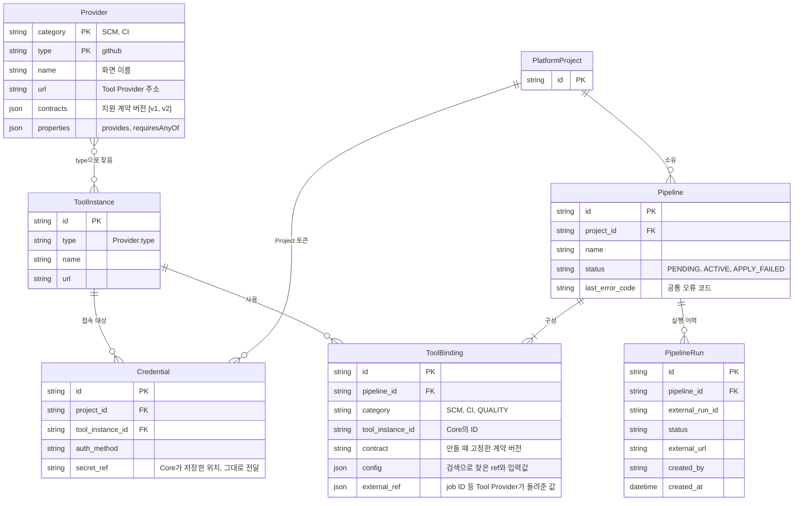

# 도구 연동은 카테고리별 Provider SPI와 운영 조직이 배포하는 원격 Tool Provider로 만든다

GitHub, GitLab 같은 저장소와 GitHub Actions, Jenkins 같은 빌드 도구를 여러 인스턴스로 연결하고, 화면과 MCP에서 파이프라인을 구성하고 실행한다.
같은 카테고리에 도구를 추가할 때(Bitbucket, 두 번째 품질 도구)는 Platform 코드를 고치지 않는다. 새 카테고리를 추가할 때(첫 품질 도구, CNPG)는 그 카테고리의 업무 규칙만큼 Platform 코드가 늘어난다.

조건은 세 가지다.

- Platform Backend는 Core 앱과 Pipeline 앱으로 나누고, 배포 주기가 다르다.
- 도구는 Platform과 다른 조직이 운영하고, 도구마다 운영 조직이 다를 수 있다. 지금은 GitHub 팀(GitHub, Actions)과 GitLab·Jenkins 팀 두 곳이다.
- 도구마다 인스턴스가 여러 개다. 지금은 GitHub, GitLab, Jenkins가 2대씩이다.

그래서 업무 코드는 카테고리별 SPI(`ScmProvider`, `CiProvider`)만 보고, 도구별 변환은 운영 조직이 배포하는 Tool Provider 앱이 맡는다. Platform 쪽 SPI 구현은 REST로 Tool Provider를 부르는 `RestScmProvider` 하나뿐이다. 컴포넌트 사이는 이벤트 없이 동기 호출로 잇는다.
이 설계는 도구 간 이식성이 아니라 공통 워크플로(등록, 검증, 적용, 실행, 상태 조회)와 공통 관리(권한, 토큰, 오류 형식)를 제공한다. Jenkins 파이프라인을 Actions로 옮기는 일은 다루지 않는다.

## Status

Accepted (설계 확정 2026-11-09, 마이크로커널 구조로 수정 2026-11-10, Provider SPI와 원격 Tool Provider로 다시 정리 2026-11-11). 구현 전이다.

## 구성

```
Web·BFF·MCP → Pipeline 앱 ─┐
                           ├─ ScmProvider, CiProvider (SPI)
Core 앱 ───────────────────┘    └ RestScmProvider, RestCiProvider ─HTTP→ Tool Provider ─→ Tool Instance
Core 앱: Provider 등록, Tool Instance, Credential, resolve API
```

| 구성 | 운영 | 역할 | 하지 않는 일 |
|---|---|---|---|
| Core 앱 | 플랫폼 팀 | Provider와 Tool Instance 등록, Credential 쓰기, Tool 정보 조회(resolve) API | 도구별 변환 |
| Pipeline 앱 | 플랫폼 팀 | 파이프라인 업무 규칙, 저장, 호출 순서. SPI로 도구를 부른다 | 도구 이름에 따른 분기, 토큰 읽기 |
| Tool Provider | 도구 운영 조직 | SPI를 REST로 구현한다. 공통 요청을 도구 API로, 도구 응답과 오류를 공통 모양으로 바꾼다 | 사용자 권한 판단, 데이터 저장, Platform 호출 |
| Tool Instance | 도구 운영 조직 | 실제 도구 서버 | - |

| Tool Provider | 운영 조직 | Provider 키 |
|---|---|---|
| gh-provider | GitHub 팀 | `SCM/github`, `CI/github`(Actions) |
| gl-jk-provider | GitLab·Jenkins 팀 | `SCM/gitlab`, `CI/jenkins` |

### 용어

| 용어 | 뜻 | 예 |
|---|---|---|
| 카테고리(category) | 도구가 맡는 기능. Platform 코드에 있는 닫힌 목록이고, 카테고리마다 SPI가 하나 있다 | `SCM`, `CI`, `QUALITY`, `DATABASE` |
| 타입(type) | 도구 종류. Admin이 Provider를 등록할 때 넣는 문자열(소문자, 하이픈) | `github`, `gitlab`, `jenkins` |
| Provider SPI | 카테고리별 Java 인터페이스. 업무 코드가 보는 유일한 도구 계약 | `ScmProvider`, `CiProvider` |
| Provider | 카테고리와 타입 한 조합의 등록 정보. 키는 `{category}/{type}`이다 | `SCM/gitlab` → gl-jk-provider |
| Tool Provider | Provider SPI를 REST로 구현하는 원격 앱. 운영 조직마다 둔다 | gh-provider |
| Tool Instance | 실제 도구 서버. 타입만 갖고, 같은 타입의 여러 카테고리에 쓰인다 | `github-1`(SCM과 CI 모두) |

"Provider"는 모두 같은 SPI를 만족하는 것을 가리킨다. 앞에 카테고리를 붙이면 계약(`ScmProvider`), Rest를 붙이면 Platform 쪽 원격 구현(`RestScmProvider`), Tool을 붙이면 원격 앱(Tool Provider)이다. 레지스트리나 조회기처럼 SPI를 만족하지 않는 것에는 Provider를 쓰지 않는다.

### 계층과 패턴

```
app service → ScmProvider ← RestScmProvider ─HTTP→ Tool Provider 입구 → 도구별 Adapter → 도구 API
                (SPI)        (Remote Proxy)          (서버 스켈레톤)      (변환)
```

| 패턴 | 자리 | 뜻 |
|---|---|---|
| 포트와 어댑터 | SPI와 그 구현 | 업무 코드는 포트(SPI)만 본다 |
| 부패 방지 계층(ACL) | Tool Provider | 도구 모델이 업무 모델에 스며들지 않게 막는다. 네트워크 너머로 떨어진 어댑터 본체다 |
| Remote Proxy | `RestScmProvider` | 메서드 호출을 HTTP로 나르기만 한다. 도구를 모른다 |
| Remote Facade | SPI 메서드 | 원격 왕복을 줄이도록 굵은 단위(`prepare`, `apply`, `run`)로만 둔다 |

Tool Provider 안의 구조(도구별 Adapter, 고르기 방식)는 운영 조직의 구현 문제이고, 이 결정의 계약이 아니다. 계약은 SPI와 그에 대응하는 REST API뿐이다.

## 결정

1. **카테고리별 SPI**: Platform은 카테고리마다 SPI를 하나 둔다(`ScmProvider`, `CiProvider`). 업무 코드(app service)는 SPI만 부르고, 타입을 읽거나 분기하지 않는다. 카테고리를 하나의 SPI로 합치거나 타입마다 SPI를 두지 않는다.
2. **Platform 쪽 구현은 REST 하나**: SPI의 Platform 쪽 구현은 카테고리마다 `RestScmProvider` 하나다. 타입별 클래스(`GitHubScmProvider`)는 Platform에 만들지 않는다. SPI와 REST 클라이언트는 공유 라이브러리로 Core 앱과 Pipeline 앱이 함께 쓴다. 이 라이브러리에는 도구별 코드가 없으므로 계약이 바뀔 때만 바뀐다.
3. **REST 경로**: Tool Provider는 `/{contract}/{category}/{type}/{동작}` 경로로 SPI를 제공한다(예: `/v1/scm/github/prepare`). 경로로 도구별 Adapter가 정해지므로 요청 본문에 타입을 넣지 않는다. SPI 메서드 하나가 엔드포인트 하나에 대응한다. 계약은 OpenAPI 파일 하나로 두고, 양쪽 코드와 DTO를 여기서 만든다.
4. **Provider 등록**: Platform Admin이 `POST /providers { category, type, name, url, contracts, properties }`로 등록한다. Core는 `GET {url}/v1/{category}/{type}/health`로 실제 제공 여부를 확인하고, 404면 거부한다. 그래서 타입의 오타나 임의 등록이 막힌다. manifest는 쓰지 않는다.
5. **Provider 키는 바꾸지 않는다**: 키 `{category}/{type}`은 유일하고, 등록 뒤에는 바꾸거나 지울 수 없다(인스턴스, 바인딩, 비밀 경로가 참조한다). `url`, `contracts`, `properties`, `name`은 고칠 수 있다.
6. **Tool Instance**: Core가 관리한다. Admin은 이미 등록된 Provider의 타입 중에서 고르기만 한다(직접 입력 없음). 인스턴스는 타입만 갖고, 쓸 때 바인딩의 카테고리를 붙여 Provider 키를 만든다(`github-1` + `CI` → `CI/github`). 그래서 GitHub 서버 하나를 저장소와 Actions에 함께 쓴다.
7. **도구 조합**: Provider `properties`에 저장소는 제공 특성(`provides`), 빌드는 필요 특성을 "이 중 하나"(`requiresAnyOf`)로 Admin이 적는다. 겹치는 값이 없으면 업무 오류다. Platform은 도구 이름을 모른 채 값만 비교한다.
8. **Tool 정보 조회(resolve)**: Core가 `resolve(projectId, category, instanceId)`로 Tool Provider 주소, 타입, 인스턴스 주소, `secretRef`를 한 번에 돌려준다. Pipeline 앱은 짧게 캐시한다. Tool Provider는 상태 없이 매 호출에 받은 것으로만 일하고, Platform에 되묻지 않는다.
9. **비밀값**: Credential은 Project와 인스턴스 한 쌍마다 하나다. Core만 비밀 저장소에 쓰고 지운다(읽지 않는다). Pipeline 앱은 접근하지 않는다. Tool Provider는 읽기만 하고, 읽기 권한은 자기 타입의 경로로 나눈다. 토큰을 바꿀 때는 같은 위치에 덮어쓰고 버전을 두지 않는다. `secretRef`는 Core가 저장한 값을 그대로 전달하며, Tool Provider는 해석하지 않는다. Tool Provider는 토큰을 오래 캐시하지 않는다.
10. **앱 간 인증(약식)**: 사용자가 시킨 호출은 Platform이 받은 사용자 JWT를 그대로 Tool Provider에 넘긴다. 사용자가 없는 호출(예약 실행, 재시도)은 Core와 Pipeline이 함께 쓰는 서비스 계정 JWT로 부른다. Tool Provider는 서명과 `iss`를 검사하고 Platform의 `aud`를 받아들이며, 감사 로그에 `sub`, `azp`를 남긴다. 받은 JWT를 다른 서비스로 다시 넘기지 않는다. 토큰 교환(RFC 8693)은 하지 않는다.
11. **계약 버전**: 계약의 주인은 플랫폼 팀이다. 필드나 엔드포인트 추가는 같은 버전 안에서 하고, 받는 쪽은 모르는 필드를 무시한다. 깨지는 변경만 새 버전을 만든다. Tool Provider는 옛 버전과 새 버전을 함께 제공하고, Admin이 Provider의 `contracts`에 새 버전을 더한다. Platform은 현재 버전과 바로 전 버전까지만 지원한다.
12. **바인딩 버전 고정**: 바인딩은 자기 `contract`를 저장한다. 새 바인딩은 Provider `contracts`의 최신 버전으로 고정하고, 저장된 바인딩은 저장된 버전으로 부른다. 기록이 없는 옛 바인딩은 v1로 본다. 버전 올리기는 Tool Provider의 `migrate` 엔드포인트나 사용자의 다시 저장으로만 한다. 옛 버전 바인딩이 0개가 되면 운영 조직이 옛 버전을 내린다.
13. **파이프라인 구조와 순서**: `Pipeline`은 `bindings`(카테고리 + 인스턴스 + `config` + `contract`) 목록을 갖는다. 순서는 카테고리 순번(`Category.order`)이 정한다. 순번 1(`SCM`, `QUALITY`)을 `prepare`하고 받은 값(`Part`)을 순번 2(`CI`)의 `apply`에 넘긴다. 같은 순번은 app service가 동시에 부른다. SPI 호출 한 번은 바인딩 하나를 대상으로 하고, 여러 도구를 한꺼번에 부르는 일은 RestScmProvider가 아니라 app service가 한다.
14. **도구별 데이터와 값 전달**: 양식(`config-schema`)과 검증은 Tool Provider가 맡고, 값은 Platform DB에 JSON으로 저장한다. Platform은 내용을 해석하지 않는다. Tool Provider끼리 호출하지 않고, clone 주소나 스캔 정보는 Platform이 받아서 다음 호출에 넘긴다.
15. **적용과 실행**: `PENDING` 저장 → `apply` → 성공 시 `ACTIVE`, 실패 시 `APPLY_FAILED`. `apply`는 같은 Pipeline ID로 다시 불러도 덮어쓴다. 실행은 접수 후 실행 ID를 받고 `status`를 동기로 조회한다. 도구에서 직접 고친 것은 감지하거나 되돌리지 않는다.
16. **공통 오류 코드**: Tool Provider는 아래 코드 중 하나로 오류를 돌려주고, `RestScmProvider`가 이를 Java 예외(`ToolError`)로 바꾼다.

| 코드 | 뜻 | Platform 처리 |
|---|---|---|
| `UNSUPPORTED` | 지원 안 하는 기능 | 업무 오류 |
| `INVALID_CONFIG` | 입력 오류(필드별 메시지 포함) | 입력 양식에 표시 |
| `AUTH_FAILED` | 도구 토큰 오류 | Credential 수정 안내 |
| `NOT_FOUND` | 도구에 대상 없음 | "다시 적용" 안내 |
| `TOOL_UNAVAILABLE` | 도구 장애, 시간 초과 | 재시도 안내 |

## 엔티티

모두 Platform DB에 저장한다. Tool Provider에는 엔티티가 없다. `Provider`, `ToolInstance`, `Credential`은 Core 앱이, 나머지는 Pipeline 앱이 소유한다.



- `Provider`의 키 `(category, type)`은 바꾸거나 지울 수 없다. `ToolInstance`가 참조하는 타입도 마찬가지다.
- `Credential`은 `(project_id, tool_instance_id)`가 유일하다.
- `ToolBinding`은 `Pipeline`을 통해서만 바꾸고, Tool Instance는 ID로만 참조한다.
- 입력 양식과 품질 결과는 저장하지 않고 Tool Provider에서 실시간으로 읽는다.

## 코드 구조

### 클래스 군

| 위치 | 클래스 군 | 역할 | 참조 대상 |
|---|---|---|---|
| 공유 라이브러리 | SPI `ScmProvider`, `CiProvider`, DTO, `ToolError` | 카테고리별 계약. OpenAPI에서 만든다 | 없음 |
| 공유 라이브러리 | `RestScmProvider`, `RestCiProvider` | SPI 구현. resolve 결과로 경로를 만들어 HTTP로 부르고, 오류 코드를 예외로 바꾼다. 사용자 JWT나 서비스 JWT를 붙인다 | `ToolResolver`, Tool Provider |
| Core 앱 | `ProviderService`, `ToolInstanceService`, `CredentialService` | Provider 등록과 health 확인, 인스턴스 등록, Credential 쓰기와 verify | `Provider`, `ToolInstance`, `Credential`, `SecretStore`(쓰기), SPI |
| Core 앱 | `ResolveController` | 내부 resolve API | Core 저장소 |
| Pipeline 앱 | `PipelineController`, `RunController` | 인증, 권한 확인, app service 호출 | app service |
| Pipeline 앱 | `PipelineService`, `RunService` | 호출 순서, 같은 순번의 동시 호출, 트랜잭션 경계 | 엔티티, `ToolCompatibility`, SPI, 저장소 |
| Pipeline 앱 | `Pipeline`, `ToolBinding`, `Category`, `PipelineRun` | 상태 전이와 불변식 | 다른 엔티티의 ID만 |
| Pipeline 앱 | `ToolCompatibility` | `provides`와 `requiresAnyOf` 비교 | resolve가 준 properties |
| Pipeline 앱 | `CoreToolResolver` | `ToolResolver` 구현. Core resolve API 호출과 캐시 | Core 앱 |
| Tool Provider | 경로별 Controller, 도구별 Adapter | 예시일 뿐 계약이 아니다 | 비밀 저장소(읽기), Tool Instance |

### SPI와 원격 구현

```java
// 공유 라이브러리: 카테고리별 SPI
interface ScmProvider {
  List<Ref> search(ToolRef tool, String q);
  Part prepare(ToolRef tool, Config config);
}
interface CiProvider {
  void validate(ToolRef tool, Config config);
  ExternalRef apply(ToolRef tool, Config config, List<Part> parts);
  RunId run(ToolRef tool, ExternalRef ref);
}
// ToolRef = projectId, instanceId, contract (바인딩에서 만든다)

// 공유 라이브러리: SPI의 유일한 Platform 쪽 구현
class RestScmProvider implements ScmProvider {
  public Part prepare(ToolRef tool, Config config) {
    var t = resolver.resolve(tool.projectId(), SCM, tool.instanceId());
        // providerUrl, type, instance url, secretRef
    return http.post(t.providerUrl() + "/" + tool.contract() + "/scm/" + t.type() + "/prepare",
                     Request.of(t.instance(), t.secretRef(), config));   // 오류 코드 → ToolError
  }
}

// Pipeline 앱: 카테고리 순서
enum Category {
  SCM(1), QUALITY(1),   // 같은 순번은 서로 의존하지 않음
  CI(2);                // 순번 1의 결과(Part)를 받음
  final int order;
}

// Pipeline 앱: app service는 SPI만 부른다
Pipeline register(Project project, Bindings bindings) {
  compatibility.check(bindings);
  ci.validate(bindings.ci().ref(), bindings.ci().config());
  var pipeline = pipelineRepo.save(Pipeline.pending(project, bindings));

  var parts = pipeline.preparing().parallelStream()      // 순번 1, 동시 호출
      .map(b -> preparers.of(b.category()).prepare(b.ref(), b.config())).toList();
  try {
    var build = pipeline.ci();                           // 순번 2
    pipeline.activate(ci.apply(build.ref(), build.config(), parts));
  } catch (ToolError e) {
    pipeline.fail(e);
  }
  return pipelineRepo.save(pipeline);
}
```

### 구현 기술

Java 진영에는 원격 플러그인의 등록과 선택까지 해 주는 오픈소스(Go의 hashicorp/go-plugin 같은 것)가 없다. 등록과 resolve는 직접 만들고, 호출과 계약은 아래 도구를 조합한다.

| 자리 | 기술 | 이유 |
|---|---|---|
| `RestScmProvider`의 HTTP 호출 | Spring HTTP Interface(`@HttpExchange`) | 인터페이스만으로 클라이언트가 생기고 가볍다. 호출마다 Tool Provider 주소가 다르므로 메서드 인자 `URI`로 넘긴다 |
| 계약 | OpenAPI Generator | 계약 파일 하나에서 양쪽 DTO와 서버 뼈대를 만든다 |
| 계약 깨짐 확인 | Spring Cloud Contract 또는 Pact | 조직 사이의 계약 변경을 테스트로 잡는다 |

## 다른 구조와의 대응

| 이 설계 | JDBC | Terraform | k8s CSI |
|---|---|---|---|
| `ScmProvider` SPI | `java.sql` 인터페이스 | Provider 프로토콜 | CSI 스펙 |
| Tool Provider | 드라이버 | Provider 바이너리 | CSI 드라이버 |
| `Provider(category, type)` | 등록된 드라이버 | Provider 안의 리소스 타입 | `CSIDriver` 객체 |
| Tool Instance | DataSource 연결 정보 | provider 구성 블록 | StorageClass 파라미터 |
| Credential | DB 계정 | provider 인증 설정 | Secret |
| `external_ref` | - | state | PV |

다른 점은 세 가지다.

- **순서**: Terraform은 참조를 분석해 그래프로 순서를 정한다. 여기서는 카테고리 순번으로 고정한다(결정 13).
- **plan과 refresh**: Terraform과 k8s는 현재 상태를 읽어 차이를 계산한다. 여기서는 하지 않는다(결정 15).
- **도구 선택**: CSI는 드라이버를 사용자에게 감추지만, 여기서는 사용자가 인스턴스를 직접 고른다.

## API

### Core 앱

| API | 권한 | 내용 |
|---|---|---|
| `POST·GET /v1/providers` | Platform Admin | Provider 등록(health 확인), 조회 |
| `PATCH /v1/providers/{category}/{type}` | Platform Admin | `url`, `contracts`, `properties`, `name` 수정. 키는 못 바꾼다 |
| `POST /v1/tool-instances` | Platform Admin | 인스턴스 등록. 타입은 등록된 Provider에서 고른다 |
| `GET /v1/tool-instances?category=SCM` | 로그인 사용자 | 카테고리에 쓸 수 있는 인스턴스와 properties. DB만 조회한다 |
| `PUT /v1/projects/{id}/tools/{instanceId}/credential` | Project Owner | Project 토큰 등록. 비밀 저장소에 쓰고 verify |
| `GET /internal/v1/resolve?projectId&category&instanceId` | 서비스 계정 | Tool Provider 주소, 타입, 인스턴스 주소, `secretRef` |

### Pipeline 앱

| API | 권한 | 내용 |
|---|---|---|
| `GET /v1/projects/{id}/tools/{instanceId}/search?category=SCM&q=` | Project Member | 검색해서 ref 찾기 |
| `GET /v1/projects/{id}/tools/{instanceId}/config-schema?category=CI` | Project Member | 입력 양식 |
| `POST·GET·PUT /v1/projects/{id}/pipelines` | Project Member | 파이프라인 등록, 조회, 수정 |
| `DELETE /v1/pipelines/{id}`, `POST /v1/pipelines/{id}/apply` | Project Member | 삭제, 다시 적용 |
| `POST /v1/pipelines/{id}/runs`, `GET /v1/pipelines/{id}/runs/{runId}` | Project Member | 실행, 상태 |

### Tool Provider (계약)

모든 요청 본문에 `instance(id, url)`, `secretRef`가 들어가고, 헤더에 사용자 JWT나 서비스 계정 JWT가 붙는다.

| 경로 | 내용 |
|---|---|
| `GET /{v}/{category}/{type}/health` | 등록 확인 |
| `POST /{v}/{category}/{type}/verify` | 토큰으로 접속 확인 |
| `POST /{v}/{category}/{type}/search`, `GET .../config-schema`, `POST .../validate` | 공통 |
| `POST /{v}/scm/{type}/prepare` | clone 주소 등 접속 정보 |
| `POST /{v}/ci/{type}/apply`, `.../remove`, `.../runs`, `.../runs/status` | 빌드 |
| `POST /{v}/{category}/{type}/migrate` | 옛 버전 config와 external_ref를 이 버전 모양으로 바꾼다 |

## 호출 순서

예시는 Platform Project `p1`이다.

### 1. 도구 준비 (처음 아무것도 없을 때)

```
GitHub 팀: gh-provider 배포 (scm/github, ci/github 경로 제공)
GitLab·Jenkins 팀: gl-jk-provider 배포 (scm/gitlab, ci/jenkins 경로 제공)

Admin → Core: POST /v1/providers { category: SCM, type: github, url: gh-provider, contracts: [v1], properties: { provides: [git, actions] } }
  Core → gh-provider: GET /v1/scm/github/health          (404면 거부)
Admin → Core: CI/github { requiresAnyOf: [actions] }, SCM/gitlab { provides: [git] }, CI/jenkins { requiresAnyOf: [git] }

Admin → Core: POST /v1/tool-instances { type: github, name: github-1, url }   (github-2, gitlab-1·2, jenkins-1·2도 같음)

Project Owner → Core: PUT /v1/projects/p1/tools/gitlab-2/credential { authMethod, values }
  Core → 비밀 저장소: 쓰기 → secretRef
  Core → gl-jk-provider: POST /v1/scm/gitlab/verify { instance, secretRef }   (실패면 AUTH_FAILED)
  Core: Credential 저장
```

| Provider | Tool Provider | 쓸 수 있는 인스턴스 |
|---|---|---|
| `SCM/github` | gh-provider | github-1, github-2 |
| `CI/github` | gh-provider | github-1, github-2 |
| `SCM/gitlab` | gl-jk-provider | gitlab-1, gitlab-2 |
| `CI/jenkins` | gl-jk-provider | jenkins-1, jenkins-2 |

### 2. 파이프라인 등록

```
저장소 고르기
Web → Core: GET /v1/tool-instances?category=SCM       → github-1·2, gitlab-1·2 (DB 조회)
Web → Pipeline: GET /v1/projects/p1/tools/gitlab-2/search?category=SCM&q=app
  Pipeline: 권한 확인
  RestScmProvider → Core: resolve(p1, SCM, gitlab-2)   (캐시)
  RestScmProvider → gl-jk-provider: POST /v1/scm/gitlab/search { instance, secretRef, query }
    gl-jk-provider → 비밀 저장소: secretRef로 읽기
    gl-jk-provider → GitLab 2: 저장소 검색             → [{ id, name, url }]

빌드 고르기
Web → Core: GET /v1/tool-instances?category=CI&scm=gitlab-2  → jenkins-1·2 (Actions는 조합이 안 맞아 빠짐)

저장
Web → Pipeline: POST /v1/projects/p1/pipelines
  Pipeline: 권한 확인, 조합 검사, 바인딩 contract를 최신(v1)으로 고정
  → gl-jk-provider: POST /v1/ci/jenkins/validate
  Pipeline: PENDING 저장
  → gl-jk-provider: POST /v1/scm/gitlab/prepare       → cloneUrl
  → gl-jk-provider: POST /v1/ci/jenkins/apply (cloneUrl 포함)
  Pipeline: ACTIVE와 jobId 저장, 실패면 APPLY_FAILED
```

```json
POST /v1/projects/p1/pipelines
{
  "name": "app-build",
  "bindings": [
    { "category": "SCM", "tool": "gitlab-2", "config": { "repository": "team/app" } },
    { "category": "CI", "tool": "jenkins-1", "config": { "branch": "main", "buildCommand": "./gradlew build" } }
  ]
}
```

### 3. 계약 버전이 올라갈 때

```
GitLab·Jenkins 팀: gl-jk-provider가 /v1과 /v2를 함께 제공하도록 배포
Admin → Core: PATCH /v1/providers/CI/jenkins { contracts: [v1, v2] }   (health로 /v2 확인)
  기존 바인딩: v1으로 계속 호출
  새 바인딩: v2로 고정
  옮기기: Pipeline → POST /v2/ci/jenkins/migrate { config, external_ref } → 바인딩 contract를 v2로
v1 바인딩이 0개가 되면 운영 조직이 /v1을 내린다
```

## 도구를 추가할 때

| 추가 | 운영 조직 | Platform Admin | Platform 코드 |
|---|---|---|---|
| 같은 타입의 인스턴스(github-3) | 없음 | 인스턴스 등록 | 없음 |
| 기존 카테고리의 새 타입(Bitbucket) | Tool Provider에 경로 추가, 배포 | Provider 등록 | 없음 |
| 같은 이름이지만 API가 다른 제품(Bitbucket Cloud와 Data Center) | 다른 타입으로 경로 추가 | 다른 Provider로 등록 | 없음 |
| 새 카테고리(첫 품질 도구) | 새 Tool Provider 배포 | Provider 등록 | `QualityProvider` SPI, `RestQualityProvider`, `QUALITY` 순번, 빌드 단계의 스캔 정보 처리 |

## Considered Options

- **도구별 직접 호출**: 업무 코드에 도구 분기가 생기고, 같은 도구 코드가 Core와 Pipeline 두 앱에 들어간다.
- **SPI 하나(`Resource(kind, spec)`)로 일반화**: 카테고리가 늘어도 코드가 그대로지만 업무 규칙을 담을 자리가 없다.
- **타입마다 SPI**: 업무 코드가 도구 이름을 알게 된다.
- **파이프라인 Provider 하나**: 하나가 모든 저장소와 빌드의 짝을 알아야 한다.
- **도구별 Provider를 Platform 안에 두기(Spring 빈, 공유 라이브러리)**: 가장 단순하지만, 도구가 바뀔 때 배포 주기가 다른 두 앱을 함께 배포해야 하고 운영 조직이 소유하지 못한다.
- **Core에만 도구별 Provider를 두고 Pipeline이 Core를 부르기**: Core가 도구 변경에 묶이고, 운영 조직이 소유하지 못한다.
- **Spring Cloud OpenFeign**: 재시도와 장애 차단(Resilience4j)을 붙이기 쉽지만 Spring Cloud 의존이 는다. 재시도 규칙을 정할 때 다시 본다.
- **gRPC**: Terraform처럼 바이너리 계약을 쓰지만, 화면에서 부르는 동기 호출에는 무겁고 디버깅이 어렵다.
- **Apache Dubbo**: SPI와 RPC를 함께 주지만, Tool Provider도 Dubbo를 써야 해서 운영 조직의 기술 선택을 묶는다.
- **플러그인 jar 로딩(PF4J, Spring Plugin, OSGi, ServiceLoader)**: 네트워크가 없지만 남의 코드가 Platform 안에서 돌고, 두 앱을 다시 띄워야 한다. 네트워크 비용이 문제가 되면 두 번째 선택지다. SPI가 같으므로 나중에 바꿀 수 있다.
- **설정 기반 변환(요청·응답 템플릿)**: 코드 배포가 없지만 Jenkins job XML이나 페이지 넘김 같은 일을 감당하지 못한다.
- **Crossplane, Terraform provider에 맡기기**: 비동기라 동기 호출 결정과 맞지 않고 운영 도구가 하나 는다.
- **이벤트, 큐와 작업자**: 호출 흐름을 따라가기 어렵다.
- **Composite가 같은 카테고리의 Provider를 한꺼번에 부르기**: 순서와 부분 실패 처리 같은 업무 규칙이 어댑터에 숨는다.
- **manifest로 Provider 등록**: 운영 조직이 정보를 알리지만, manifest의 키가 바뀌면 Platform 데이터의 연결이 무너진다. 지금은 키 네 개라 Admin 등록과 health 확인으로 충분하다. Tool Provider와 키가 수십 개로 늘면 다시 보되, 그때도 키의 주인은 Platform이다.
- **Tool Provider 단위로 묶어 등록(ToolBackend 표)**: 주소를 한 곳에서 고치지만 개념이 하나 는다. 같은 url이 여러 줄에 들어가는 것으로 충분하다.
- **요청 본문의 type으로 고르기**: 경로로 고르면 Tool Provider 안의 분기가 사라지고, 로그와 접근 제어를 도구별로 나눌 수 있다.
- **Tool Instance를 Tool Provider의 데이터로 두기**: 운영 조직이 서버를 직접 관리하지만, 화면 목록을 모든 Tool Provider에 물어야 하고, 원격에서 지우면 바인딩과 Credential이 깨지고, Tool Provider에 상태가 생긴다. 인스턴스가 아주 많고 자주 바뀌면 다시 본다. 이때도 호출 모양 차이는 `RestScmProvider`에서 맞춘다.
- **secretRef를 경로 규칙으로 만들기, 짧은 Credential ID 쓰기**: 경로 규칙이 계약에 들어간다. 저장한 값을 그대로 넘기면 경로 모양을 Core만 안다.
- **토큰 버전 관리**: 지금은 덮어쓰기로 충분하다.
- **토큰 교환(RFC 8693)이나 서비스 JWT + 사용자 ID 헤더**: 더 안전하지만 IdP 의존과 구현 부담이 크다.
- **Tool Provider를 MCP 서버로 직접 열기**: Tool Provider가 사용자 권한을 판단해야 하고, 인가 규칙이 두 곳에 생긴다.
- **버전을 키에 넣기(`SCM/github-v2`)**: 인스턴스의 타입과 비밀 경로가 갈라진다.
- **없으면 최신 버전으로 호출**: 새 버전이 나오는 순간 옛 바인딩이 말없이 넘어가 깨진다.
- **참조 그래프로 호출 순서 계산(Terraform 방식)**: 지금 의존은 "빌드는 앞 단계 결과가 필요하다" 하나뿐이다.
- **조합을 도구 이름 목록으로 선언**: GitLab을 추가할 때 Jenkins까지 고쳐야 한다.
- **토큰을 Platform에 암호화 저장**: 모든 도구의 토큰이 Platform에 모이고, Platform이 다시 읽을 수 있다.

## Consequences

- REST 계약이 조직 사이의 API가 된다. 깨지는 변경은 운영 조직이 옛 버전과 새 버전을 함께 운영해야 하고, migrate를 제공해야 한다.
- 운영 조직이 새 타입을 배포해도 Admin이 Provider를 등록하기 전에는 쓸 수 없다.
- Pipeline 앱의 도구 호출은 Core의 resolve API에 기댄다. 캐시가 짧으면 Core 장애가 곧 도구 호출 장애가 된다.
- 비밀 저장소가 멈추면 도구 호출 전체가 멈춘다. 읽기 권한은 Tool Provider마다 관리해야 한다.
- 사용자 JWT를 그대로 넘기므로, Tool Provider가 뚫리면 그 토큰으로 Platform을 부를 수 있다(token passthrough 금지 원칙 위반 소지). Tool Provider는 직접 호출과 대리 호출을 토큰으로 구분하지 못한다.
- 새 카테고리를 추가하면 SPI, REST 구현, 업무 도메인이 Platform에 늘어난다. 이는 업무 규칙이 카테고리마다 달라서 필요한 비용이다.

## 미정

- 시간 초과와 재시도 규칙, 장애 시 Pipeline 앱의 처리
- 요청 ID를 Platform에서 Tool Provider, 도구까지 넘기는 방법
- MCP 도입: Platform MCP 서버(docs/agent/0002)가 `/providers`로 도구 목록을 만드는 방식
- 외부 호출(개인 토큰): 개인 Credential, 비밀 경로, 토큰 교환 필요 여부
- 스캔 토큰처럼 빌드 도구가 실행 중에 쓰는 비밀값의 전달 방식
- 품질 도구와 빌드 도구의 조합 검사 기준
- OAuth처럼 화면 이동이 필요한 인증 방식의 등록 흐름
- 쓰는 중인 Provider의 `contracts`에서 옛 버전을 뺄 때 막을지, 경고만 할지
- Credential이 없는 인스턴스를 목록에서 숨길지, 표시만 할지
- 같은 타입의 서버를 서로 다른 조직이 운영하게 될 때의 라우팅
